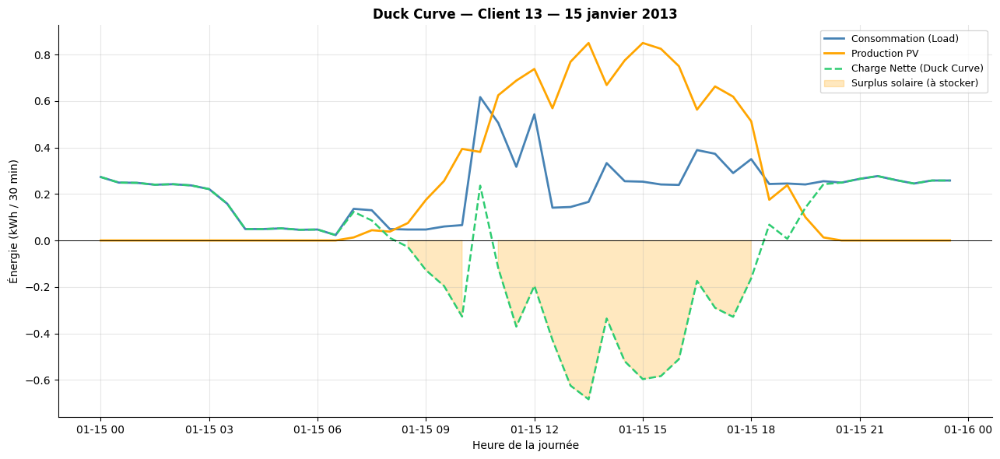
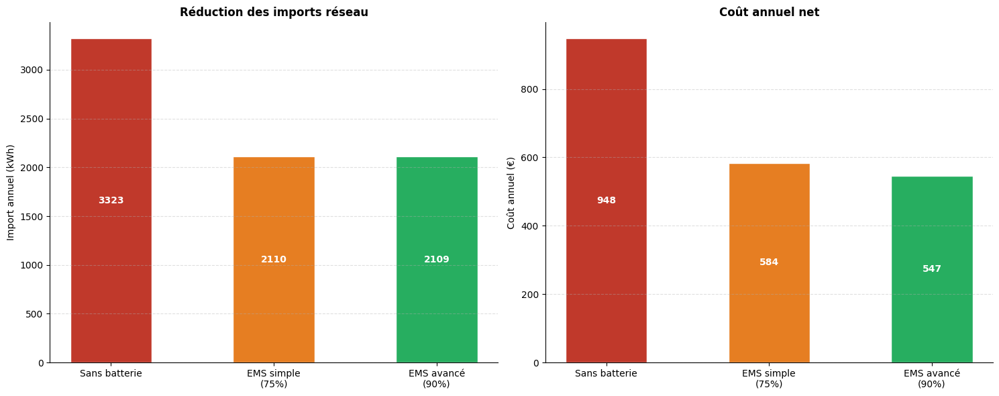
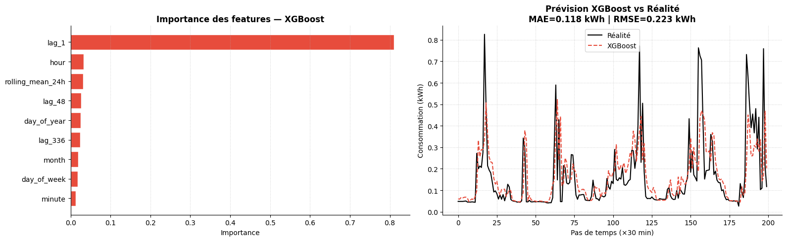

# Residential microgrid: battery dispatch and load forecasting

First-year research project at École des Ponts ParisTech (2026), Data Science for Complex Systems, Co-Innovation Lab.
Supervisor: Mohamed Saâd El Harrab.
Team: Océane Chia, Chahine Mazouzi, Thineesh Puvikaran, Matéo Renoir, Linley Sham-Praderio, Clovis Vialard.

**Question.** How much can a 7 kWh home battery, driven by a simple energy management system (EMS), reduce a household's grid imports and electricity bill, and how well can next-step consumption be forecast?

## Data

[Ausgrid Solar Home Electricity Data](https://data.nsw.gov.au/data/dataset/solar-home-electricty-data): half-hourly consumption and rooftop PV generation for 300 households in New South Wales, July 2010 to June 2013.

- Wide-to-long reshaping (`pandas.melt`), timestamp reconstruction, 2011-2012 and 2012-2013 files concatenated.
- Anomaly screening (holiday profiles, inverter failures, PV recorded at night): 54 usable households out of 300.
- Reference household: customer 13 (Ratnam et al., 2015).

The raw CSV files are **not** included in this repository. See [`data/README.md`](data/README.md).

## Methods

| Block | Approach |
|---|---|
| Energy balance | Net load = load − PV; surplus, grid import/export, self-consumption |
| Battery model | 7 kWh, SOC in [10 %, 90 %], 1.5 kWh max per 30 min step, 75 % or 90 % efficiency |
| Greedy EMS | Charge on solar surplus, discharge on deficit, at each 30 min step |
| Tariff-aware EMS | Peak 0.40 €/kWh (17h-21h), off-peak 0.20 €/kWh, feed-in 0.08 €/kWh |
| LP benchmark | Linear program (PuLP, CBC solver) minimising the annual net cost, used as an optimal reference for the greedy EMS |
| Forecasting | LSTM (48-step window) vs XGBoost (lags at 30 min, 24 h, 7 days, 24 h rolling mean); chronological 70/15/15 split; direct multi-step XGBoost up to +3 h |

## Results (customer 13, July 2012 to June 2013, as computed in the notebook)

| Scenario | Annual grid import | Annual net cost |
|---|---|---|
| No battery | 3,323 kWh | 948 € |
| Greedy EMS, 75 % efficiency | 2,110 kWh (−36.5 %) | 584 € |
| Tariff-aware EMS, 90 % efficiency | 2,109 kWh (−36.5 %) | 547 € |
| LP optimum (same battery, full year) | | 481 € |

- The greedy EMS costs about 12 % more than the LP optimum over the year.
- Estimated savings of the tariff-aware EMS: about 400 €/year, i.e. a payback of roughly 12 years for a 5,000 € battery.

| Forecast model (next 30 min) | MAE | RMSE |
|---|---|---|
| LSTM | 0.125 kWh | 0.233 kWh |
| XGBoost | 0.118 kWh | 0.223 kWh |
| XGBoost, mean over +30 min to +3 h | 0.202 kWh | |





## Limitations

- A single household; results are not representative of the whole population.
- The greedy EMS is myopic; the forecasts are not yet coupled with the controller (next step: model predictive control).
- Simplified tariffs, no battery degradation.
- The LSTM scaler is fitted on the whole series before the chronological split, which slightly leaks test-set information.

## Repository layout

```
notebooks/microgrid_ems.ipynb   full pipeline (data, EMS, LP, forecasting), with outputs
report/                         project report (French, 10 pages)
figures/                        figures exported from the notebook
data/                           instructions to download the Ausgrid files (data not versioned)
```

## Run it

Google Colab: open the notebook, put the Ausgrid folders on your Drive and set `DRIVE_DATA_DIR` in the first code cell.

Locally (Python 3.10 or later):

```bash
python -m venv .venv
source .venv/bin/activate        # Windows: .venv\Scripts\activate
pip install -r requirements.txt
jupyter notebook notebooks/microgrid_ems.ipynb
```

The LSTM training and the full-year LP take several minutes; the full-year LP needs a few GB of RAM.

## Reference

E. L. Ratnam, S. R. Weller, C. M. Kellett, A. T. Murray. *Residential load and rooftop PV generation: an Australian distribution network dataset.* International Journal of Sustainable Energy, 2015. doi:10.1080/14786451.2015.1100196
